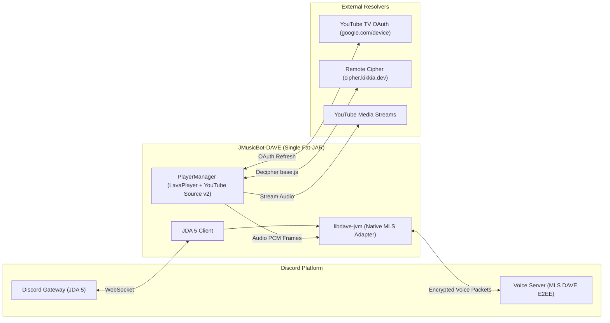

# 🎵 JMusicBot-DAVE

<p align="center">
  
</p>

<p align="center">
  <strong>A modern, 100% standalone Java Discord music bot featuring native Discord DAVE (MLS E2EE) voice encryption, YouTube TV OAuth 2.0, and automated remote cipher decoding.</strong>
</p>

<p align="center">
  <a href="https://github.com/wynoislive/JMusicBot-DAVE/releases/latest"></a>
  <a href="https://github.com/wynoislive/JMusicBot-DAVE/blob/main/LICENSE"></a>
  
  
  
  
</p>

---

## ⚡ Why JMusicBot-DAVE?

In late 2024–2025, Discord rolled out **DAVE** (Discord's Audio & Video End-to-End Encryption protocol using MLS). Legacy music bots suddenly went silent with voice connection timeouts. In parallel, YouTube tightened bot detection on datacenter IPs, breaking standard web and android player clients.

Most modern fixes require complex external server runtimes—forcing users to orchestrate Node.js bridges (NodeLink), external Lavalink servers, multiple ports, and high RAM consumption.

**JMusicBot-DAVE restores full music playback in a single, lightweight fat-JAR:**
- 🔒 **Native DAVE (MLS E2EE) Voice Encryption:** Embedded directly into JDA via JNI (`libdave-jvm:adapter-jda`). No broken voice handshakes.
- ☕ **100% Standalone (Zero External Servers):** No Lavalink, no NodeLink, no Node.js required. Just `java -jar JMusicBot.jar`.
- 📺 **YouTube TV OAuth 2.0 Device Flow:** Bypass YouTube bot detection via TV authentication (`google.com/device`) with automatic token caching.
- 🔑 **Automated Remote Signature Cipher:** Built-in integration with `https://cipher.kikkia.dev` decodes YouTube's latest obfuscated player scripts (`base.js`) in under 1 second.
- 🪶 **Minimal Resource Footprint:** Tuned for Serial Garbage Collection (`-XX:+UseSerialGC -Xms64M -Xmx256M`). Operates smoothly on servers with 256MB RAM.
- 🥚 **Turnkey Pelican & Pterodactyl Egg:** Pre-configured with automatic release downloads and web panel environment variable synchronization.

---

## 🏛️ Architecture Overview



---

## 🚀 Quick Start Guide

### Option 1: Pelican / Pterodactyl Panel (Recommended)

1. Download the [**`egg-jmusicbot-dave.yaml`**](https://raw.githubusercontent.com/wynoislive/JMusicBot-DAVE/main/egg-jmusicbot-dave.yaml) egg file.
2. In your panel admin area, go to **Nests** ➔ **Import Egg** and select `egg-jmusicbot-dave.yaml`.
3. Create a new server using the imported egg and docker image `ghcr.io/pterodactyl/yolks:java_17`.
4. Fill in the environment variables:
   - **`BOT_TOKEN`**: Your Discord bot token from [Discord Developer Portal](https://discord.com/developers/applications).
   - **`BOT_OWNER`**: Your 17–20 digit Discord User ID.
5. Start the server!
   - On first startup, the console will display a YouTube authorization link (e.g. `https://www.google.com/device`) and a 8-character code.
   - Open the link, enter the code, and grant access. The token is automatically saved to `youtube_oauth_token.txt` and preserved across restarts.

---

### Option 2: Standalone VPS / Local Machine

#### Prerequisites
- **Java 17 or higher (64-bit)**
  ```bash
  java -version
  ```

#### Installation Steps
1. Download the latest `JMusicBot.jar` from the [Releases Page](https://github.com/wynoislive/JMusicBot-DAVE/releases/latest).
2. Create a folder and place `JMusicBot.jar` inside it.
3. Run the bot once to generate `config.txt`:
   ```bash
   java -Dnogui=true -jar JMusicBot.jar
   ```
4. Open `config.txt` in a text editor:
   - Put your bot token in `token = "..."`
   - Put your Discord user ID in `owner = 123456789012345678`
5. Start the bot with recommended memory-efficient flags:
   ```bash
   java -Dnogui=true -XX:+UseSerialGC -Xms64M -Xmx256M -jar JMusicBot.jar
   ```

---

## ⚙️ Configuration Reference (`config.txt`)

| Option | Type | Default | Description |
| :--- | :---: | :---: | :--- |
| `token` | String | `BOT_TOKEN_HERE` | Your Discord bot token. |
| `owner` | Long | `0` | Your Discord user ID (used for owner-only commands). |
| `prefix` | String | `!` | The command trigger prefix. |
| `useytoauth` | Boolean | `true` | Enables YouTube TV OAuth 2.0 authentication. |
| `remotecipherurl` | String | `https://cipher.kikkia.dev` | Remote endpoint for deciphering restricted YouTube audio signatures. |
| `updatealerts` | Boolean | `true` | Notifies the owner via DM when a new release is published. |
| `stayinchannel` | Boolean | `false` | Keeps the bot in the voice channel after the queue ends. |
| `songinstatus` | Boolean | `false` | Shows the currently playing song title in the bot's Discord activity. |
| `maxytplaylistpages` | Integer | `10` | Maximum pages of YouTube playlists to import (100 tracks per page). |
| `alonetimeuntilstop` | Long | `0` | Seconds to wait before leaving an empty voice channel (`0` to disable). |

---

## 📋 Commands Reference

### 🎧 Music Playback
| Command | Usage | Description |
| :--- | :--- | :--- |
| `!play <title \| URL>` | `!play never gonna give you up` | Plays a track or adds it to the queue. |
| `!search <query>` | `!search lofi hip hop` | Searches YouTube and presents track selection. |
| `!pause` | `!pause` | Pauses the current track. |
| `!play` | `!play` | Resumes playback if paused. |
| `!skip` | `!skip` | Votes to skip the current track. |
| `!nowplaying` / `!np` | `!np` | Displays current track details and progress bar. |
| `!queue` | `!queue [page]` | Lists all songs in the current playback queue. |
| `!shuffle` | `!shuffle` | Randomizes the current queue order. |
| `!volume` | `!volume <0-150>` | Adjusts playback volume (requires DJ or Admin role). |
| `!repeat` | `!repeat <all \| single \| off>` | Sets track or queue repeat mode. |
| `!stop` | `!stop` | Stops playback, clears the queue, and leaves voice. |

### 🛠️ Administrative & Moderation
| Command | Usage | Description |
| :--- | :--- | :--- |
| `!settc <#channel>` | `!settc #music-bot` | Restricts music commands to a specific text channel. |
| `!setvc <voice channel>`| `!setvc Music Lounge` | Restricts bot to a specific voice channel. |
| `!setdj <@role>` | `!setdj DJ` | Sets the DJ role for skipping without voting. |
| `!skipto <index>` | `!skipto 4` | Skips directly to a specific track number in queue. |
| `!forceskip` | `!forceskip` | Immediately skips track without voting (DJ/Admin). |

### 👑 Bot Owner Commands
| Command | Usage | Description |
| :--- | :--- | :--- |
| `!setgame <game>` | `!setgame listening to music` | Updates Discord status activity. |
| `!setname <name>` | `!setname JMusicBot` | Changes the bot's username on Discord. |
| `!setavatar <url>` | `!setavatar https://...` | Updates the bot's profile picture. |
| `!shutdown` | `!shutdown` | Safely disconnects voice and shuts down bot. |

---

## 🛠️ Building from Source

Ensure you have **JDK 17** and **Maven** installed:

```bash
# Clone the repository
git clone https://github.com/wynoislive/JMusicBot-DAVE.git
cd JMusicBot-DAVE

# Build the shaded fat-JAR
mvn clean package -DskipTests

# The compiled JAR will be in target/
ls -lh target/JMusicBot.jar
```

---

## ❓ Frequently Asked Questions & Troubleshooting

<details>
<summary><strong>Q: Why does the bot ask me to visit google.com/device on startup?</strong></summary>
<br>
YouTube requires authentication to allow datacenter IPs (like VPS, Hetzner, OVH, AWS) to stream music without encountering anti-bot CAPTCHAs. JMusicBot-DAVE uses YouTube TV OAuth. You only need to authenticate once; the token is automatically saved to <code>youtube_oauth_token.txt</code> for all future reboots.
</details>

<details>
<summary><strong>Q: I get <code>Must find sig function from script</code> errors. How do I fix it?</strong></summary>
<br>
This happens when YouTube updates its player script (<code>base.js</code>). In JMusicBot-DAVE v1.0.6+, the remote cipher endpoint is pre-configured to <code>https://cipher.kikkia.dev</code>, which resolves player scripts automatically. Ensure <code>remotecipherurl = "https://cipher.kikkia.dev"</code> is set in your <code>config.txt</code>.
</details>

<details>
<summary><strong>Q: Can I run this with limited RAM?</strong></summary>
<br>
Yes! JMusicBot-DAVE is specifically optimized to use a non-allocating audio frame buffer and Serial Garbage Collection. Use these flags in your launch command:
<pre><code>java -Dnogui=true -XX:+UseSerialGC -Xms64M -Xmx256M -jar JMusicBot.jar</code></pre>
</details>

---

## 📄 License & Acknowledgments

- **Original JMusicBot:** Copyright &copy; 2018–2023 John Grosh ([jagrosh](https://github.com/jagrosh/MusicBot)), licensed under the [Apache 2.0 License](https://github.com/wynoislive/JMusicBot-DAVE/blob/main/LICENSE).
- **DAVE MLS Protocol:** Powered by [libdave-jvm](https://github.com/freyacodes/libdave-jvm) by Freya Arbjerg.
- **Lavalink YouTube Source:** Maintained by [lavalink-devs](https://github.com/lavalink-devs/youtube-source).
- **Remote Cipher Service:** Hosted by [kikkia.dev](https://kikkia.dev).
