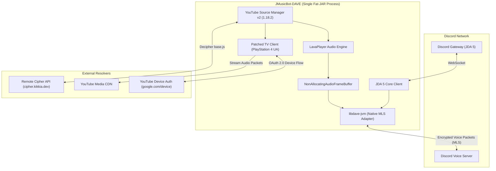

<p align="center">
  <a href="https://github.com/wynoislive/JMusicBot-DAVE">
    
  </a>
</p>

<h1 align="center">JMusicBot-DAVE</h1>

<p align="center">
  <strong>The 100% Pure Java, Standalone Discord Music Bot with Native DAVE (MLS E2EE) Voice Encryption, YouTube TV OAuth 2.0, and Automated Remote Cipher Resolution.</strong>
</p>

<p align="center">
  <a href="https://github.com/wynoislive/JMusicBot-DAVE/releases/latest"></a>
  <a href="https://github.com/wynoislive/JMusicBot-DAVE/blob/main/LICENSE"></a>
  
  
  
</p>

<p align="center">
  <a href="https://github.com/wynoislive/JMusicBot-DAVE/releases/latest/download/JMusicBot.jar">
    
  </a>
  &nbsp;
  <a href="https://github.com/wynoislive/JMusicBot-DAVE/releases/latest/download/egg-jmusicbot-dave.yaml">
    
  </a>
</p>

---

## 💡 The Problem & The Solution

In late 2024–2025, Discord rolled out **DAVE** (Discord's Audio & Video End-to-End Encryption protocol using MLS). Legacy music bots suddenly went completely silent with infinite voice reconnect loops. Simultaneously, YouTube began aggressively challenging datacenter IP addresses, blocking standard Web and Android player clients.

Other solutions force you to manage multi-container Docker Compose stacks, open multiple networking ports, and maintain heavy Node.js bridges (NodeLink or external Lavalink servers) consuming 500MB–1GB+ RAM.

**JMusicBot-DAVE solves this by restoring full, high-fidelity music playback inside a single, pure Java fat-JAR.**

### 📊 Architectural Comparison

| Feature | Classic JMusicBot | NodeLink / Lavalink Stacks | 🎵 JMusicBot-DAVE |
| :--- | :---: | :---: | :---: |
| **Discord DAVE (MLS E2EE) Audio** | ❌ Broken (Disconnects) | ⚠️ Partial (Depends on Node backend) | ✅ **Native JNI (`libdave-jvm`)** |
| **Process Model** | Single JAR | Multi-Process (Node + Java + Ports) | ✅ **Single Standalone JAR** |
| **External Dependencies** | Zero | Node.js, Lavalink, Redis, etc. | ✅ **Zero External Dependencies** |
| **RAM Consumption** | ~100MB | 500MB – 1.2GB | ✅ **~128MB – 256MB (SerialGC)** |
| **YouTube Anti-Bot Defense** | ❌ Blocked | ⚠️ IP rotation / Proxies | ✅ **TV OAuth 2.0 (`google.com/device`)** |
| **Signature Cipher Solver** | ❌ Stale Regex | Manual Script Extraction | ✅ **Auto (`cipher.kikkia.dev`)** |
| **Pelican / Pterodactyl Egg** | Outdated | Requires Multi-Port Configuration | ✅ **1-Click Native Egg Included** |

---

## 🏛️ System Architecture



---

## 🚀 Quick Start Guide

### 🥚 Option 1: Pelican / Pterodactyl Panel (Recommended)

> [!TIP]
> The included egg automatically fetches the latest stable release of `JMusicBot-DAVE` from GitHub and keeps configuration in sync.

1. Download [`egg-jmusicbot-dave.yaml`](https://github.com/wynoislive/JMusicBot-DAVE/releases/latest/download/egg-jmusicbot-dave.yaml).
2. Go to your Panel Admin: **Nests** ➔ **Import Egg** ➔ Select `egg-jmusicbot-dave.yaml`.
3. Create a server using the egg with:
   - **Docker Image:** `ghcr.io/pterodactyl/yolks:java_17`
   - **Memory:** 256MB–512MB
4. Set your environment variables in the panel:
   - `BOT_TOKEN`: Your Discord Bot Token ([Discord Developer Portal](https://discord.com/developers/applications))
   - `BOT_OWNER`: Your 17–20 digit Discord User ID
5. Start your server! On first launch, follow the **YouTube TV OAuth** prompt in the console.

---

### 💻 Option 2: Standalone VPS / Local PC

#### Requirements
- **Java 17 or higher (64-bit)**
  ```bash
  java -version
  ```

#### Installation
1. Download `JMusicBot.jar` from the [Latest Release](https://github.com/wynoislive/JMusicBot-DAVE/releases/latest).
2. Create a clean folder and place `JMusicBot.jar` inside.
3. Run the bot once to generate the default `config.txt`:
   ```bash
   java -Dnogui=true -jar JMusicBot.jar
   ```
4. Open `config.txt` and fill in:
   ```hocon
   token = "YOUR_DISCORD_BOT_TOKEN"
   owner = 123456789012345678
   ```
5. Launch with optimized low-memory flags:
   ```bash
   java -Dnogui=true -XX:+UseSerialGC -Xms64M -Xmx256M -jar JMusicBot.jar
   ```

---

## 📺 First-Time YouTube TV OAuth Setup

When JMusicBot-DAVE starts for the first time, you will see this in the console:

```log
[INFO] [YoutubeOauth2Handler]: Go to https://www.google.com/device and enter code XXXX-XXXX
```

1. Open **[https://www.google.com/device](https://www.google.com/device)** in your web browser.
2. Sign in and enter the 8-character code shown in your console.
3. Approve access for **YouTube on TV**.
4. The bot will automatically acquire and store the refresh token in `youtube_oauth_token.txt`:
   ```log
   [INFO] [JMusicBot]: YouTube OAuth: Token acquired and saved to /home/container/youtube_oauth_token.txt
   [INFO] [JMusicBot]: YouTube OAuth: Authenticated via cached/configured refresh token.
   ```
5. **You're done!** All future restarts will refresh the token automatically.

---

## ⚙️ Configuration Reference (`config.txt`)

```hocon
/// START OF JMUSICBOT CONFIG ///

// Discord Bot Token
token = "YOUR_BOT_TOKEN"

// Bot Owner Discord User ID (Numeric ID)
owner = 123456789012345678

// Command prefix
prefix = "!"

// Online presence
game = "DEFAULT"
status = ONLINE
songinstatus = false

// YouTube TV OAuth 2.0 (Bypasses bot blocks)
useytoauth = true
ytoauth = ""

// Remote Cipher Endpoint (Solves latest player scripts)
remotecipherurl = "https://cipher.kikkia.dev"

// Update alerts via Discord DM
updatealerts = true

// Audio & Queue Settings
stayinchannel = false
maxtime = 0
maxytplaylistpages = 10
alonetimeuntilstop = 0

/// END OF JMUSICBOT CONFIG ///
```

---

## 📋 Bot Commands

<details open>
<summary><strong>🎧 Music Playback Commands</strong></summary>

| Command | Usage | Description |
| :--- | :--- | :--- |
| `!play <title \| url>` | `!play bohemian rhapsody` | Plays a track or appends it to the queue. |
| `!search <query>` | `!search lofi chill` | Searches YouTube and provides interactive selection. |
| `!pause` | `!pause` | Pauses current track playback. |
| `!play` | `!play` | Resumes playback if currently paused. |
| `!skip` | `!skip` | Votes to skip the active track. |
| `!nowplaying` / `!np` | `!np` | Displays the current track details and progress bar. |
| `!queue` | `!queue [page]` | Displays the ordered playback queue. |
| `!shuffle` | `!shuffle` | Shuffles the tracks in the queue. |
| `!volume` | `!volume <0-150>` | Sets playback volume (DJ or Admin only). |
| `!repeat` | `!repeat <all \| single \| off>` | Toggles repeat modes. |
| `!stop` | `!stop` | Clears queue, stops playback, and disconnects. |

</details>

<details>
<summary><strong>🛠️ Server Administration Commands</strong></summary>

| Command | Usage | Description |
| :--- | :--- | :--- |
| `!settc <#channel>` | `!settc #music` | Restricts bot text commands to a designated channel. |
| `!setvc <name>` | `!setvc Music Room` | Locks bot to a specific voice channel. |
| `!setdj <@role>` | `!setdj DJ` | Assigns DJ role for instant skip and volume control. |
| `!forceskip` | `!forceskip` | Bypasses skip voting and skips immediately. |
| `!skipto <index>` | `!skipto 3` | Skips directly to track index in queue. |

</details>

<details>
<summary><strong>👑 Bot Owner Commands</strong></summary>

| Command | Usage | Description |
| :--- | :--- | :--- |
| `!setgame <activity>` | `!setgame listening to lofi` | Changes bot activity status. |
| `!setname <name>` | `!setname JMusicBot` | Changes the bot's Discord display name. |
| `!setavatar <url>` | `!setavatar https://...` | Updates the bot's avatar image. |
| `!shutdown` | `!shutdown` | Safely disconnects and shuts down the process. |

</details>

---

## ❓ Troubleshooting & FAQ

> [!NOTE]
> **Q: Why does playback say `Must find sig function from script`?**  
> **A:** YouTube regularly updates its player script (`base.js`). In **v1.0.6+**, the remote cipher is automatically directed to `https://cipher.kikkia.dev`, which resolves these scripts dynamically. Make sure your `config.txt` has `remotecipherurl = "https://cipher.kikkia.dev"`.

> [!NOTE]
> **Q: How much RAM does the bot actually need?**  
> **A:** Because JMusicBot-DAVE uses a non-allocating audio frame buffer and Serial Garbage Collection, the heap stays between **48MB and 120MB**. A 256MB container is more than enough for 24/7 uninterrupted playback.

> [!NOTE]
> **Q: Can I disable update alerts in my Discord DMs?**  
> **A:** Yes! Simply change `updatealerts = true` to `updatealerts = false` in `config.txt`.

---

## 📜 Credits & License

- **JMusicBot Original:** Copyright &copy; 2018–2023 John Grosh ([jagrosh](https://github.com/jagrosh/MusicBot)) under [Apache License 2.0](LICENSE).
- **Discord DAVE E2EE:** Powered by [libdave-jvm](https://github.com/freyacodes/libdave-jvm) by Freya Arbjerg.
- **YouTube Source:** Maintained by [lavalink-devs](https://github.com/lavalink-devs/youtube-source).
- **Remote Cipher Service:** Hosted by [cipher.kikkia.dev](https://cipher.kikkia.dev).
